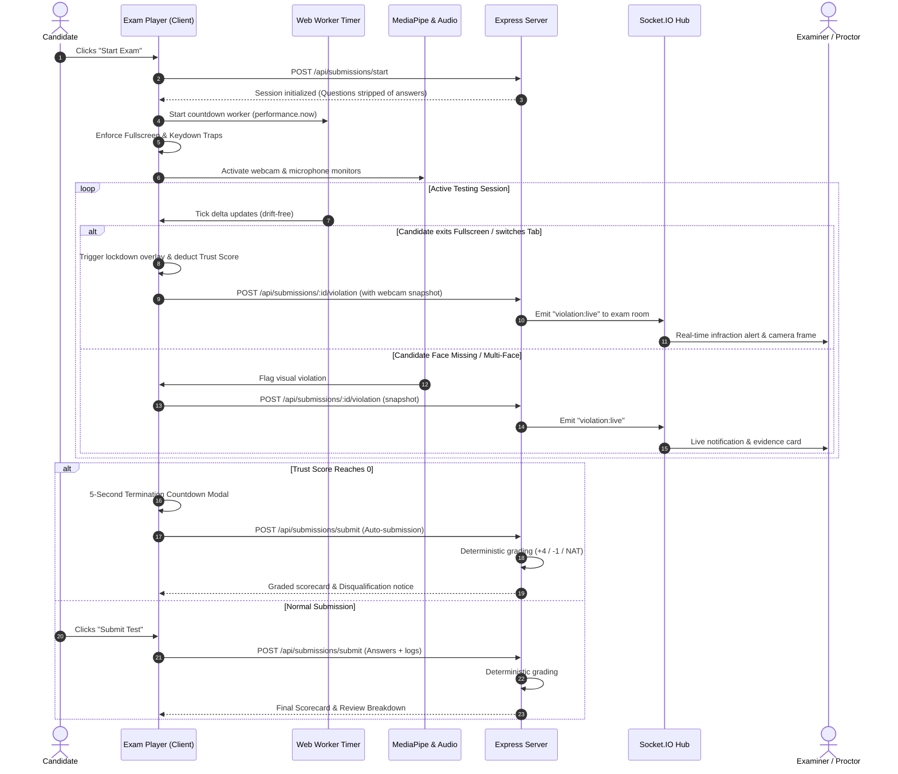
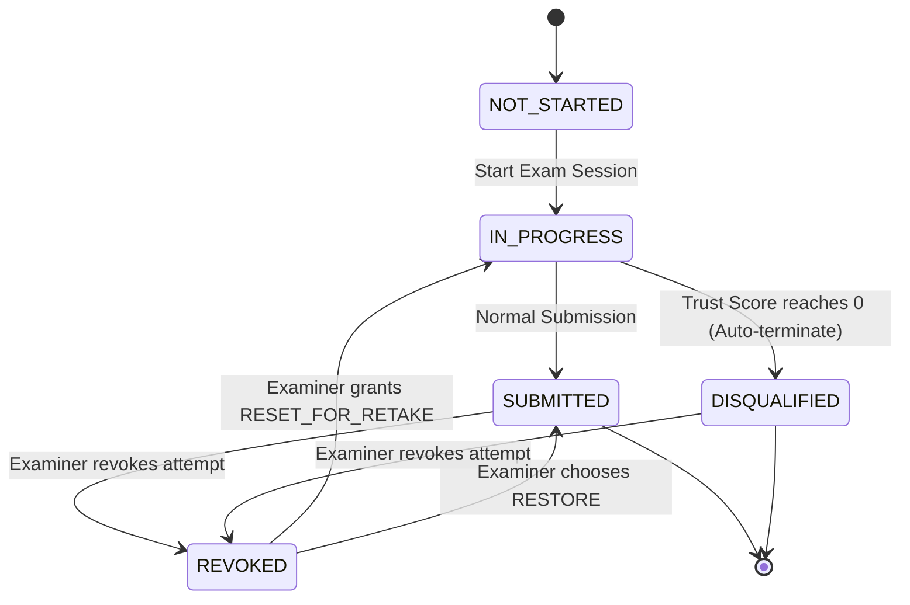

<div align="center">

# 🎓 Mock Test Canvas

### Enterprise-Grade AI-Proctored Computer-Based Testing Platform
**Engineered for High-Stakes Competitive Examinations (JEE Advanced, NEET, GATE & Aptitude)**

[](https://mock-test-canvas.vercel.app)
[](https://mock-test-canvas.onrender.com/api/health)
[](https://react.dev/)
[](https://tailwindcss.com/)
[](https://nodejs.org/)
[](https://www.mongodb.com/atlas)
[](https://aistudio.google.com/)
[](https://opensource.org/licenses/MIT)

<p align="center">
  <a href="#-executive-summary">Executive Summary</a> •
  <a href="#-key-features">Key Features</a> •
  <a href="#-system-architecture--workflows">Architecture</a> •
  <a href="#-technology-stack--manifest">Tech Stack</a> •
  <a href="#-security--proctoring-perimeter">Proctoring Engine</a> •
  <a href="#-project-directory-structure">Project Structure</a> •
  <a href="#-environment-configuration">Configuration</a> •
  <a href="#-getting-started">Getting Started</a> •
  <a href="#-api-documentation">API Reference</a>
</p>

</div>

---

## 🌟 Executive Summary

**Mock Test Canvas** is an enterprise-grade, full-stack assessment portal designed to replicate the exact visual layout, behavioral constraints, and computational rigor of national-level computer-based examinations (such as India's **NTA JEE Advanced / Main**, **NEET**, and **GATE**).

Built on **React 19**, **Tailwind CSS v4**, **Node.js/Express (ES Modules)**, and **MongoDB Atlas**, Mock Test Canvas seamlessly bridges real-world high-stakes testing conditions with modern web intelligence:
- 🖥️ **Authentic Exam Canvas**: Pixel-perfect national exam player with KaTeX LaTeX math rendering, section navigation, interactive question palette, and multi-format answer inputs (MCQ, MSQ, and NAT).
- 🛡️ **Active Anti-Cheat Perimeter**: Fullscreen enforcement with gesture gates, Page Visibility traps, Alt+Tab blur interceptors, input suppression, and a zero-drift Web Worker countdown clock with wall-clock drift correction.
- 📷 **On-Device Vision & Audio AI Proctoring**: Client-side MediaPipe vision tracking (face absence, multiple occupants, gaze deviation), Web Audio API decibel monitoring, and automated Cloudinary snapshot evidence capture.
- ⚖️ **Dynamic Trust Score Engine ($100 \rightarrow 0$)**: Proportional penalty system with 10-second anti-spam cooldowns, persistent cross-refresh violation logging, critical warning overlays, and automated test termination.
- 🧮 **Deterministic Server-Side Grading Engine**: Strict answer-key projection safeguards preventing client-side network snooping, coupled with authentic marking scheme computation (+4 / -1, partial MSQ scoring, and NAT tolerance bounds).
- 🤖 **Multimodal AI Question Ingestion**: Document extraction pipeline converting DOCX, PDF, and diagram images into structured LaTeX JSON tests via Google Gemini (with an automatic model fallback cascade).
- 📚 **Centralized Question Bank & Dynamic Exam Generator**: Filterable shared repository with batch selection, direct draft export, and one-click random test synthesis.
- 📡 **Live Proctor Supervision Console & Attempt Management**: Real-time WebSocket streaming (`violation:live`), candidate snapshot review, and educator attempt governance (Disqualify, Revoke, or Grant Retake).
- 📊 **Performance Analytics & BYOK AI Pedagogical Explanations**: Score progression trends, subject mastery heatmaps, decile distribution histograms, global leaderboard with personalized rank pinning, and **Bring Your Own Key (BYOK)** Gemini AI step-by-step solutions with zero server storage.

---

## 🎯 Key Features

### 1. 🖥️ Authentic National Exam Player Canvas
- **KaTeX STEM Formula Engine**: Flawless, ultra-fast client-side typography for complex mathematical formulas, matrices, definite integrals, fractions, chemical reaction pathways, and Greek symbols.
- **Multi-Format Question Canvas**:
  - **Single-Choice Questions (MCQ)**: Single selection with instant option clearing.
  - **Multiple-Choice Questions (MSQ)**: Multi-selection checkboxes supporting partial and full correct scoring.
  - **Numerical Answer Type (NAT)**: Virtual on-screen keypad and decimal validation for authentic numerical entry.
- **Interactive Question Palette**: Color-coded question states matching standard testing bodies: *Not Visited*, *Not Answered*, *Answered*, *Marked for Review*, and *Answered & Marked for Review*.
- **Section & Subject Switcher**: Smooth transitions across Physics, Chemistry, and Mathematics sections with individual question status counters.
- **Crash & Reload Resilience**: Powered by Zustand and `localStorage` synchronization; accidental reloads or connection drops restore responses, flags, and the timer without data loss.

### 2. 🛡️ Advanced In-Browser Lockdown & Anti-Cheat
- **Zero-Drift Web Worker Timer**: Defeats browser background tab throttling. Runs in an isolated Web Worker thread computing high-precision `performance.now()` deltas, reconciled against wall-clock timestamps upon window refocus.
- **Fullscreen Enforcer with User-Gesture Gate**: Prohibits testing outside full-screen mode. Detects exits instantly, freezes the interface behind an unclosable warning overlay, registers infractions, and guides candidates through browser gesture re-entry.
- **Tab & Window Focus Trapping**:
  - Intercepts the **Page Visibility API** (`visibilitychange`) to catch tab switching.
  - Intercepts **Window Blur** (`blur`) to catch Alt+Tab and OS-level application switching.
  - Smart co-fire debouncer prevents double penalty deductions when switching tabs triggers blur and visibility events concurrently.
- **Wall-Clock Tab Return Penalties & Extended Absence**: Time spent outside the tab is deducted from the exam clock upon return. Absences exceeding 30 seconds trigger scaled `EXTENDED_ABSENCE` deductions (up to -20 trust penalty).
- **Comprehensive Shortcut & DevTools Suppression**:
  - Disables right-click context menu (`contextmenu`).
  - Blocks clipboard operations: Copy (`Ctrl+C`), Cut (`Ctrl+X`), Paste (`Ctrl+V`), and Select All (`Ctrl+A`).
  - Suppresses DevTools and inspect shortcuts: `F12`, `Ctrl+Shift+I`, `Ctrl+Shift+J`, `Ctrl+Shift+C`, `Ctrl+Shift+K`, `Ctrl+U` (View Source), `Ctrl+S`, `Ctrl+P`, and `Alt+F4`.

### 3. 📷 On-Device ML Vision & Audio AI Proctoring
- **MediaPipe Edge ML Vision**: Executes `@mediapipe/tasks-vision` models directly in the candidate's browser without sending continuous video to servers, preserving privacy and eliminating bandwidth bottlenecks:
  - **No Face Detected (`NO_FACE`)**: Detects when candidate steps away from the camera.
  - **Multiple Faces Detected (`MULTI_FACE`)**: Detects unauthorized helpers or collaborators in frame.
  - **Gaze & Head Deviation**: Flags prolonged abnormal head yaw, pitch, or looking away from the screen.
- **Web Audio Decibel Anomaly Hook**: Real-time microphone monitoring via Web Audio API flags noise spikes, whispers, or candidate coaching (`NOISE_SPIKE`).
- **Cloudinary Snapshot Evidence**: Captures automated, timestamped webcam frames upon violation triggers and securely uploads them to Cloudinary for post-exam educator audit inspection.

### 4. ⚖️ Tiered Trust Score Engine ($100 \rightarrow 0$)
- Every candidate starts the test with a pristine **100 Trust Score**.
- Infractions deduct points proportional to cheating intent:
  - **Fullscreen Exit**: `-20 pts` (deliberate window drop)
  - **Tab Switch**: `-15 pts` (external lookup attempt)
  - **Multi-Face in Frame**: `-20 pts` (third-party coaching risk)
  - **No Face Detected**: `-15 pts` (candidate left station)
  - **Extended Absence (>30s)**: `-10` to `-20 pts` (scaled by duration)
  - **Window Focus Lost**: `-10 pts` (background app switch)
  - **Noise Anomaly**: `-10 pts` (coaching or conversation spike)
- **10-Second Cooldown Anti-Spam**: Prevents multiple penalties from stacking on a single accidental window flicker.
- **Critical Early Warning**: An alert modal triggers when trust drops to $\le 30$.
- **Automated Termination & Eviction**: If trust reaches $0$, a 5-second countdown modal activates, locking the canvas and automatically submitting the paper with disqualification flags.
- **Cross-Session Storage**: Violations and trust scores persist across browser refreshes for the active test session, preventing candidates from clearing penalties with F5.

### 5. 🧮 Deterministic Server-Side Grading Engine
- **Zero Client Answer Exposure**: The `GET /api/exams/:id` endpoint projects out `correctAnswers` and `explanation` via Mongoose (`-correctAnswers -explanation`). Answer keys never touch client memory during the test.
- **Strict Server Evaluation**: Scoring is executed entirely on the backend (`grading.service.js`):
  - Accurate positive marks for correct selections.
  - Negative marks for wrong selections.
  - Multi-select matching (MSQ) precision.
  - Numerical range bounds verification for NAT questions.
- **Attempt History & Auditing**: Tracks historical attempts, scores, time spent per question, accuracy percentages, and photographic violation logs.

### 6. 🤖 Multimodal AI Question Ingestion (Gemini 2.5 / 3.8 Flash)
- **Multi-Format Document Parsing**: Upload raw `.docx`, `.pdf`, or scanned question diagram images directly into the Test Creator studio (`/create-test`).
- **Automated Structuring**: Google Gemini extracts question statements, options, correct keys, and step-by-step solutions into structured JSON schema with LaTeX formulas.
- **Automatic Model Fallback Cascade**: If a configured model is busy or rate-limited, the backend automatically cascades through fallback models (`gemini-2.5-flash-lite`, `gemini-flash-latest`, `gemini-3.6-flash`, `gemini-2.5-flash`).
- **Ingestion Review Studio**: Interactive modal preview allowing educators to review, edit, discard, or batch-import AI-extracted questions before publishing.

### 7. 📚 Centralized Question Bank & Dynamic Test Generator
- **Global Question Repository (`/question-bank`)**: Search and filter thousands of questions across categories, subjects, topics, and difficulty levels.
- **Batch Selection & Direct Draft Export**: Select multiple questions with checkbox controls to bulk-tag, bulk-delete, or export directly into a new or active Test Creator draft.
- **Dynamic Exam Synthesis (`/api/questions/generate-exam`)**: Automatically generate balanced, full-length mock tests on the fly matching specified subjects, streams, and question counts.
- **Cloud Diagram Management**: Direct image uploads to Cloudinary for circuit diagrams, chemical reaction mechanisms, and geometric figures.

### 8. 📡 Live Proctor Workstation & Attempt Governance
- **Real-Time WebSocket Streaming**: Dispatches instant `violation:live` socket alerts to exam creators when candidates commit infractions.
- **Dedicated Live Monitor (`/test/:testId/live`)**: Real-time supervision dashboard displaying connected test takers, live trust score gauges, telemetry KPIs, and camera snapshot feeds.
- **Attempt Revocation & Retake Engine**: Exam creators can review candidate attempts, revoke disqualified attempts, or grant fresh retakes (`RESET_FOR_RETAKE`, `DISQUALIFY`, or `RESTORE`) with reason tracking and automated candidate notifications.
- **Comprehensive Audit Dashboard (`/test/:testId/audit`)**: Timestamped violation timelines, photographic evidence gallery, and score reports for post-test integrity verification.

### 9. 📊 Performance Analytics & BYOK AI Pedagogical Explanations
- **Bring Your Own Key (BYOK) Architecture**: Candidates can supply their personal Google Gemini API key to unlock on-demand, step-by-step pedagogical solutions directly in post-exam review sheets.
- **Zero Server Retention Guarantee**: The key is stored locally in the candidate's browser, transmitted via the `X-Gemini-Key` header, instantiated in ephemeral server memory per-request, and instantly garbage-collected without ever being saved to database or logs. Automatically purged on logout.
- **Model Choice & Fallback**: Defaults to `gemini-3.8-flash` with minimal thinking configuration for instant, low-latency Server-Sent Events (SSE) streaming, cascading gracefully to `gemini-3.5-flash-lite`, `gemini-flash-latest`, and `gemini-2.5-flash-lite`.
- **Chronological Score Progression**: Interactive Recharts visualization mapping performance trajectories across official and practice attempts.
- **Subject Mastery & Topic Heatmap**: Dynamic aggregation evaluating subject streams and question tags to highlight weaknesses and track 14-day study streaks.
- **Decile Score Distribution Histogram**: Exam-level distribution histogram bucketing candidate scores into 10 deciles (0–10% through 91–100%).
- **Global Official Leaderboard**: Cheat-resilient standings table grouping official attempt performance across all candidates with personalized rank pinning.

### 10. 🔐 Dual Authentication & Access Governance
- Traditional registration/login with email, **bcrypt** salted password hashing, and email OTP verification.
- Native **Google OAuth 2.0** integration (`google-auth-library`) for instant one-tap candidate sign-in.
- Stateless, cryptographically signed JSON Web Tokens (JWT) stored in secure cookies or `Authorization: Bearer` headers.
- **Exam Visibility Modes**: Public (visible in catalog), Unlisted (shared-link-only access), and Private (creator only).
- **User-Scoped Rate Limiting**: Upgraded rate limiting keyed by authenticated `req.user._id` (with IP fallback) preventing multi-user lockout behind institutional NAT gateways.

---

## 🏗️ System Architecture & Workflows

### High-Level Component Topology

```mermaid
graph TD
    subgraph Client ["Client (React 19 + Vite 8 + Tailwind CSS v4)"]
        UI[Exam Canvas, Catalog, Studio & Analytics UI]
        Store[Zustand Stores: Auth / Exam / Proctor / Notif]
        Worker[Dedicated Web Worker: Drift-Free Timer]
        Vision[MediaPipe Edge Vision: Face & Gaze Tracking]
        Audio[Web Audio API: Decibel Anomaly Detector]
        Lockdown[Browser Lockdown & Keyboard Traps]
        KaTeX[KaTeX LaTeX Math Engine]
    end

    subgraph Security ["Security Perimeter"]
        Gate[Fullscreen Gate & Blur Traps]
        Trust[Dynamic Trust Score Engine: 100 -> 0]
        Sanitizer[Response Sanitizer: Answer Key Exclusion]
        RateLimiter[User-Scoped Rate Limiting Engine]
    end

    subgraph Server ["Server (Node.js + Express ES Modules)"]
        Router[Express REST API]
        SocketServer[Socket.IO Real-Time Gateway]
        AuthCtrl[Auth Controller: JWT + Google + OTP]
        ExamCtrl[Exam Controller: Catalog, Visibility & Authoring]
        SubCtrl[Submission Controller: Grader & Revocation Engine]
        AICtrl[AI Ingestion Controller: Gemini GenAI]
        AnalyticsCtrl[Analytics Controller: Metrics & BYOK SSE Proxy]
        GradingService[Deterministic Grading Service]
    end

    subgraph Cloud ["Cloud & Third-Party Infrastructure"]
        Mongo[(MongoDB Atlas Database)]
        Cloudinary[(Cloudinary Snapshot CDN)]
        Gemini[Google Gemini 3.8 / 2.5 Flash API]
        Vercel[Vercel Edge CDN - Frontend]
        Render[Render Web Service - API]
    end

    UI --> Store
    UI --> KaTeX
    Lockdown --> Gate --> Trust
    Vision --> Trust
    Audio --> Trust
    Worker --> Store
    Store --> Router
    Store <--> SocketServer
    Router --> RateLimiter
    RateLimiter --> Sanitizer
    Router --> AuthCtrl
    Router --> ExamCtrl
    Router --> AICtrl --> Gemini
    Router --> AnalyticsCtrl
    Router --> SubCtrl --> GradingService
    SubCtrl --> Cloudinary
    Server --> Mongo
    Client -.Deployed on.-> Vercel
    Server -.Deployed on.-> Render
```



### Live Exam & Proctoring Sequence



### Candidate Attempt State Lifecycle



---

## 🛠️ Technology Stack & Manifest

### Layer-by-Layer Technology Matrix

| Domain | Technology | Purpose & Responsibility |
| :--- | :--- | :--- |
| **Frontend Framework** | **React 19.2 + Vite 8.2** | Next-generation React build with concurrent rendering, instant HMR, and modern JSX compilation. |
| **Styling & Design** | **Tailwind CSS v4.3** | High-performance styling engine with CSS variables, glassmorphism, responsive layouts, and dark mode. |
| **State Management** | **Zustand 5.0** | Atomic client stores (`useAuthStore`, `useExamStore`, `useProctorStore`, `useNotificationStore`, `useThemeStore`) with `persist` middleware. |
| **Math Typography** | **KaTeX 0.18** | High-speed, TeX-compliant math formula rendering for complex STEM equations and notation. |
| **Edge AI Vision** | **@mediapipe/tasks-vision** | On-device face presence, multiple face detection, and head pose/gaze tracking. |
| **Real-time WebSockets** | **Socket.io + Client 4.8** | Real-time candidate proctoring alerts (`violation:live`), room synchronization, and notifications. |
| **Data Visualization** | **Recharts 3.10** | Accuracy trends, subject-wise score matrices, decile distribution histograms, and attempt telemetry charts. |
| **Backend Framework**| **Node.js + Express 4.21** | ES Modules server with async routing, structured JSON middleware, and central error handling. |
| **Database & ODM** | **MongoDB Atlas + Mongoose 8.9** | Cloud document database with strict schemas (`User`, `Exam`, `Question`, `Attempt`, `Notification`, `Otp`). |
| **Authentication** | **JWT + Google Auth Library** | Dual stateless auth: 30-day signed tokens + Google OAuth ID Token verification + Email OTP. |
| **AI Integration** | **@google/genai (Gemini API)** | Multimodal question extraction pipeline and BYOK pedagogical explanation streaming proxy. |
| **Cloud Storage** | **Cloudinary v2** | Automated hosting of proctoring violation webcam snapshots and question diagram media. |
| **Hosting & CI/CD** | **Vercel (Client) + Render (API)** | Production edge routing with HTTPS and CORS parity. |

### 📦 Complete Dependency Manifest & Rationale

#### Backend Dependencies (`server/package.json`)

| Package | Version | Category | Purpose & Architectural Rationale |
| :--- | :--- | :--- | :--- |
| **`express`** | `^4.21.2` | Web Framework | Core backend HTTP framework handling routes, controllers, middleware execution, and REST API endpoints. |
| **`mongoose`** | `^8.9.5` | Database ODM | Connects to MongoDB, manages schemas, validation, relationships, and queries for users, exams, questions, and attempts. |
| **`@google/genai`** | `latest` | AI / LLM SDK | Official Google Gemini API SDK used for automated question ingestion, test diagnostics, and step-by-step explanations. |
| **`jsonwebtoken`** | `^9.0.3` | Authentication | Issues, signs, and cryptographically verifies stateless JSON Web Tokens (JWT) for secure user sessions. |
| **`bcryptjs`** | `^3.0.3` | Security | Hashes candidate passwords with cryptographic salts before storage and validates credentials upon sign-in. |
| **`google-auth-library`** | `^11.0.2` | Authentication | Verifies Google OAuth 2.0 ID tokens sent from the frontend for seamless one-tap Google SSO sign-in. |
| **`cookie-parser`** | `^1.4.7` | Middleware | Parses incoming HTTP request cookies (`req.cookies`), allowing secure `httpOnly` JWT tokens to be read by the server. |
| **`cors`** | `^2.8.5` | Security / Networking | Cross-Origin Resource Sharing middleware enabling safe communication between frontend origins and Express backend. |
| **`express-rate-limit`** | `^7.5.0` | Security | Rate limiting middleware keyed by authenticated user ID (with IP fallback) protecting against brute force and abuse. |
| **`multer`** | `^2.3.0` | File Handling | Middleware for handling `multipart/form-data` uploads (question paper files, documents, and student profile images). |
| **`cloudinary`** | `^2.11.0` | Cloud Storage | Cloud asset management SDK used to upload, host, and serve user profile pictures, question diagrams, and proctoring snapshots. |
| **`mammoth`** | `^1.12.2` | Document Parsing | Extracts raw text from uploaded `.docx` Word documents so the AI engine can structure them into questions. |
| **`pdf-parse`** | `^1.1.1` | Document Parsing | Extracts text content from uploaded `.pdf` documents to ingest question banks and past exam papers. |
| **`nodemailer`** | `^10.0.10` | Email Service | Sends transactional emails over SMTP / API (email verification codes, OTPs, and password reset links). |
| **`socket.io`** | `^4.8.3` | Real-time WebSockets | Manages bidirectional WebSocket connections for real-time proctoring monitoring, live test synchronization, and instant alerts. |
| **`dotenv`** | `^16.4.7` | Configuration | Loads environment variables from `.env` into `process.env` (database URIs, secrets, API keys). |
| **`nodemon`** *(dev)* | `^3.1.9` | Dev Tooling | Development utility that automatically restarts the Node.js server upon file modifications. |

#### Frontend Dependencies (`client/package.json`)

| Package | Version | Category | Purpose & Architectural Rationale |
| :--- | :--- | :--- | :--- |
| **`react`** | `^19.2.8` | Core UI Library | Foundational library for building interactive, component-based user interfaces. |
| **`react-dom`** | `^19.2.8` | UI Renderer | Renders React component trees directly into the browser's Document Object Model (DOM). |
| **`react-router-dom`** | `^7.18.2` | Routing | Handles client-side routing, navigation, and protected routes (Dashboard, Exam Canvas, Studio, Audit, Analytics). |
| **`zustand`** | `^5.0.15` | State Management | Lightweight, boilerplate-free state management for user auth, live exam progress, answer states, and proctoring infractions. |
| **`axios`** | `^1.20.0` | HTTP Client | Promise-based HTTP client for making API requests with pre-configured base URLs, credentials, and interceptors. |
| **`@mediapipe/tasks-vision`** | `^1.0.1` | AI / Computer Vision | Runs on-device vision models in the browser (face detection and head pose tracking) for low-latency automated webcam proctoring. |
| **`socket.io-client`** | `^4.8.3` | Real-time WebSockets | Connects to the backend WebSocket server for receiving instant proctoring warnings and live session synchronization. |
| **`recharts`** | `^3.10.1` | Data Visualization | Renders interactive charts (accuracy trends, decile histograms, and performance breakdowns) in analytics views. |
| **`katex`** | `^0.18.1` | Math Typesetting | High-performance LaTeX rendering engine for formatting mathematical formulas, equations, and Greek symbols. |
| **`lucide-react`** | `^1.28.0` | UI Icons | Modern SVG icon library providing clean, consistent icons across buttons, inputs, alerts, and navigation. |
| **`canvas-confetti`** | `^1.9.4` | UI Effects | Renders celebratory confetti particles on completion of an exam or achievement of a high score. |
| **`tailwindcss`** | `^4.3.3` | Styling Engine | Utility-first CSS framework for creating modern, responsive styling and glassmorphism themes. |
| **`@tailwindcss/vite`** | `^4.3.3` | Build Integration | Official Vite plugin for Tailwind CSS v4, enabling seamless JIT styling compilation. |
| **`clsx`** | `^2.1.1` | Styling Utility | Utility for conditionally joining class names together. |
| **`tailwind-merge`** | `^3.6.0` | Styling Utility | Safely merges conflicting Tailwind CSS utility classes without style override bugs (used with `clsx` as `cn(...)`). |
| **`vite`** *(dev)* | `^8.2.0` | Build Tool / Bundler | Next-generation frontend tooling providing instant server start, fast HMR, and optimized production builds. |
| **`@vitejs/plugin-react`** *(dev)* | `^6.0.4` | Vite Plugin | Enables Fast Refresh and JSX transformation support for React in Vite. |
| **`oxlint`** *(dev)* | `^1.75.0` | Linter | High-speed Rust-based JavaScript/TypeScript linter for fast code analysis and error detection. |
| **`@types/react`** & **`@types/react-dom`** *(dev)* | `^19.x` | Type Definitions | TypeScript typing definitions for React and the DOM to provide IDE intellisense and autocomplete. |

---

## 🔒 Security & Proctoring Perimeter

| Cheat Vector | Threat Mechanism | Implemented Countermeasure | Architectural Outcome |
| :--- | :--- | :--- | :--- |
| **Answer Key Snooping** | Candidate checks DevTools / Network response for answers. | `GET /api/exams/:id` explicitly projects out `correctAnswers` and `explanation` (`select: '-correctAnswers -explanation'`). | **Answer keys never touch client memory** until graded on the server. |
| **Tab Hopping** | Candidate searches Google in another browser tab. | Page Visibility API hook records `TAB_SWITCH`, deducts `-15 pts`, and subtracts real elapsed wall-clock time on return. | Tab switch logged, alert modal triggers, timer penalizes time away. |
| **Application Swapping** | Candidate switches to Discord / WhatsApp / ChatGPT (`Alt+Tab`). | `window.onblur` event trap flags `WINDOW_BLUR` and deducts `-10 pts`. Co-fire debouncer eliminates false-positive double strikes. | Warning overlay covers screen until candidate refocuses the exam. |
| **Fullscreen Dropping** | Candidate minimizes browser or opens split-screen notes. | `document.fullscreenchange` detects drop out, displays an unclosable blocker, and deducts `-20 pts`. | Candidate cannot view questions until re-engaging full-screen. |
| **Extended Backgrounding**| Candidate hides the tab for minutes to pause timer. | Tab return compares wall-clock `Date.now()` vs hidden timestamp; deducts all lost time. If $>30\text{s}$, extra deduction (`-10` to `-20 pts`). | Timer cannot be frozen by backgrounding. |
| **Keyboard Inspection** | Candidate presses `F12`, `Ctrl+Shift+I`, `Ctrl+U`, `Ctrl+S`. | `keydown` event listener blocks key combinations with `preventDefault()` and `stopPropagation()`. | DevTools shortcuts and source views completely neutralized. |
| **Clipboard Copying** | Candidate copies questions to send to third parties. | Intercepts `contextmenu`, `copy`, `cut`, `paste`, and `Ctrl+C/X/V/A`. | Text selection, right-click, and clipboard copying disabled. |
| **Page Refresh Reset** | Candidate reloads page (`F5`) to wipe violation count. | `useProctorStore` persists violation history, trust score, and active `examId` to `localStorage`. | Penalties and trust score survive page refreshes intact. |
| **Absent / Second Person**| Candidate leaves webcam view or receives coaching from a helper. | MediaPipe vision detects `NO_FACE` (-15 pts) or `MULTI_FACE` (-20 pts) and uploads evidence snapshots. | Violation recorded, warning toast displayed, proctor alerted. |
| **Persistent Violations**| Candidate repeatedly ignores warnings. | If trust score drops $\le 30$, final warning triggers. At $0$, a 5-second countdown auto-submits the test. | Candidate is disqualified / auto-submitted with recorded audit trail. |
| **Attempt Retake Abuse** | Candidate clears cache to restart an exam repeatedly. | Server checks `Attempt.countDocuments()` against `exam.maxAttempts`. Exceeding limit returns `403 Forbidden`. | Candidate cannot bypass maximum attempt restrictions. |
| **Multi-Tenant IP Lockout**| Multiple candidates behind shared school / NAT IP get rate-limited. | Custom rate-limiter keys requests by authenticated `req.user._id` before falling back to IP. | Individual candidate actions are isolated; no communal lockout. |

### 📋 Proctoring Security Specification Checklist (S1 – S8)

| Spec ID | Requirement & Threat Addressed | Implementation Detail | Primary Code Reference |
| :---: | :--- | :--- | :--- |
| **`S1`** | **Per-Type Violation Cooldown (Anti-Spam)** | Enforces a minimum 10-second cooldown between consecutive infractions of the same type. Prevents an accidental window flicker from triggering multiple rapid penalties. | [`useProctorStore.js`](file:///client/src/store/useProctorStore.js) |
| **`S2`** | **Tiered Trust Score Deductions** | Assigns weighted penalties based on deliberate intent: Fullscreen Exit (`-20`), Tab Switch (`-15`), Window Blur (`-10`), No Face (`-15`), Multi-Face (`-20`), Noise Spike (`-10`). | [`auditConstants.js`](file:///client/src/utils/auditConstants.js) |
| **`S3`** | **Live Violation Broadcast & Toast Notification** | Dispatches real-time WebSocket alerts via Socket.IO (`violation:live`) to the exam creator and displays immediate feedback toasts to the candidate. | [`App.jsx`](file:///client/src/App.jsx) / [`submission.controller.js`](file:///server/src/controllers/submission.controller.js) |
| **`S4`** | **Critical Final Warning Modal** | Intercepts testing with an unmissable modal dialog when candidate reaches the penultimate strike limit or when Trust Score drops $\le 30$. | [`ExamLockdownOverlays.jsx`](file:///client/src/components/exam-player/ExamLockdownOverlays.jsx) |
| **`S5`** | **Automated Exam Termination & Eviction** | Triggers an irreversible 5-second countdown modal that locks the interface and auto-submits the candidate's test if Trust Score reaches 0 or warnings exceed limit. | [`ExamSessionPage.jsx`](file:///client/src/pages/ExamSessionPage.jsx) / [`submission.controller.js`](file:///server/src/controllers/submission.controller.js) |
| **`S6`** | **Cross-Platform Fullscreen API Guard** | Detects `document.fullscreenEnabled` to prevent crashes on non-supporting devices (e.g., Apple Safari on iOS) and emits a graceful fallback event. | [`useBrowserLockdown.js`](file:///client/src/hooks/useBrowserLockdown.js) |
| **`S7`** | **Attempt Revocation & Retake Governance** | Empowers examiners to review candidate attempts, disqualify for malpractice, or grant retakes (`RESET_FOR_RETAKE`) with reason logging. | [`AuditRevokeModal.jsx`](file:///client/src/components/audit/AuditRevokeModal.jsx) / [`submission.controller.js`](file:///server/src/controllers/submission.controller.js) |
| **`S8`** | **User-Scoped Rate Limiting Guard** | Protects API endpoints against brute force while keying tokens by `req.user._id` to prevent multi-tenant collision behind shared proxies. | [`rateLimiter.middleware.js`](file:///server/src/middleware/rateLimiter.middleware.js) |

---

## 📁 Project Directory Structure

```plaintext
mock-test-canvas/
├── client/                                # React 19 Frontend Application (Vite 8 + Tailwind CSS v4)
├── server/                                # Node.js Express REST API & Proctoring WebSocket Server
├── docs/                                  # Architectural documentation & system specifications
│   └── uml/                               # System UML diagrams (Activity, Class, Sequence, State, Use-Case)
├── vercel.json                            # Root deployment & monorepo routing configuration
├── README.md                              # Main platform documentation & architectural overview
└── README_BLUEPRINT.md                    # Master engineering blueprint & phase specifications
```

### 💻 Client Directory Structure (`client/`)

```plaintext
client/
├── index.html                             # SPA Entry HTML shell
├── package.json                           # Frontend dependencies & build scripts
├── vite.config.js                         # Vite bundler config with Tailwind CSS v4 plugin
├── vercel.json                            # Vercel SPA route rewrite rules & security headers
├── .env.example                           # Client environment variable template
├── .oxlintrc.json                         # Oxlint code quality configuration
├── public/
│   ├── favicon.ico                        # Browser tab icon
│   ├── favicon.svg                        # Vector brand favicon
│   ├── icons.svg                          # Sprite iconography sheet
│   └── _redirects                         # Static host fallback redirects
└── src/
    ├── main.jsx                           # Application bootstrapping & DOM render
    ├── App.jsx                            # Route tree, global modals & live socket alerts
    ├── App.css                            # Global animations & app-level transitions
    ├── index.css                          # Tailwind CSS v4 design tokens & glassmorphism utilities
    │
    ├── assets/
    │   ├── hero.png                       # Hero banner illustration
    │   ├── react.svg                      # React framework emblem
    │   └── vite.svg                       # Vite build tool emblem
    │
    ├── components/
    │   ├── LatexRenderer.jsx              # Direct KaTeX math formula renderer
    │   ├── common/                        # Global reusable UI widgets & modals
    │   │   ├── AuthModal.jsx              # Quick-access login/signup dialog
    │   │   ├── BackButton.jsx             # Styled navigation back button
    │   │   ├── Breadcrumbs.jsx            # Dynamic location breadcrumb trail
    │   │   ├── ConfirmLogoutModal.jsx     # Logout confirmation dialog
    │   │   ├── DeleteExamModal.jsx        # Exam / draft deletion confirmation dialog
    │   │   ├── DiscardDraftModal.jsx      # Draft discard confirmation modal
    │   │   ├── LogoutDraftModal.jsx       # Warning modal for unsaved drafts on logout
    │   │   ├── MathRenderer.jsx           # LaTeX equation parser & inline math renderer
    │   │   ├── Modal.jsx                  # Accessible base dialog component
    │   │   ├── Navbar.jsx                 # Top bar with profile, status & theme toggles
    │   │   ├── NotificationBell.jsx       # Real-time notification indicator & dropdown
    │   │   ├── ProtectedRoute.jsx         # Authentication route guard wrapper
    │   │   ├── ServerBootIndicator.jsx    # Backend health & Render cold-start status banner
    │   │   └── ThemeToggle.jsx            # Dark / light theme switcher
    │   │
    │   ├── exam/                          # Assessment cards & exam-level dialogs
    │   │   ├── AssessmentCard.jsx         # Summary assessment card with metadata
    │   │   ├── ExamCard.jsx               # Interactive exam card in catalog & dashboard
    │   │   ├── ExamFooter.jsx             # Session action bar (Clear, Mark, Next)
    │   │   ├── ExamHeader.jsx             # Top bar with countdown clock & section tabs
    │   │   ├── ExamInstructionsModal.jsx  # Test instructions & marking rules modal
    │   │   ├── ExamQuestionPaperModal.jsx # Full paper view modal for candidates
    │   │   ├── ExamScoreReport.jsx        # Graded score summary card & accuracy report
    │   │   ├── ExamSubmitModal.jsx        # Candidate exam submission review modal
    │   │   ├── QuestionWindow.jsx         # Active question statement & KaTeX container
    │   │   ├── SidebarPalette.jsx         # Question number matrix with status color codes
    │   │   └── inputs/                    # Dedicated answer input widgets
    │   │       ├── McqInput.jsx           # Single-Choice Question (MCQ) radio selector
    │   │       ├── MsqInput.jsx           # Multiple-Choice Question (MSQ) checkbox selector
    │   │       └── NatInput.jsx           # Numerical Answer Type (NAT) numeric keypad
    │   │
    │   ├── exam-detail/                   # Exam overview & pre-test configuration tabs
    │   │   ├── ExamAttemptsTab.jsx        # Historical student attempt table & scores
    │   │   ├── ExamDetailTabs.jsx         # Tab switching controller (Questions/Attempts/Rules)
    │   │   ├── ExamHeroSection.jsx        # Exam header with title, badges, visibility & start CTA
    │   │   ├── ExamPreviewModal.jsx       # Test preview modal for educators & creators
    │   │   ├── ExamProctoringTab.jsx      # Configured integrity rules & constraint checklist
    │   │   ├── ExamQuestionsTab.jsx       # Question syllabus breakdown & format summary
    │   │   └── RevealQuestionsModal.jsx   # Administrative question inspection modal
    │   │
    │   ├── exam-player/                   # Live testing environment & anti-cheat guards
    │   │   ├── ExamFullscreenGate.jsx     # User-gesture gate requesting and enforcing fullscreen
    │   │   ├── ExamHeader.jsx             # Active test timer bar & section navigator
    │   │   ├── ExamLockdownOverlays.jsx   # Fullscreen exit & window blur blocking overlays
    │   │   ├── ExamSubmissionResult.jsx   # Post-submission scorecard and integrity outcome
    │   │   ├── ExamSubmitConfirmModal.jsx # Pre-submission summary & question confirmation
    │   │   ├── QuestionCanvas.jsx         # Core question layout, math engine & options
    │   │   └── QuestionPalette.jsx        # Question grid navigation (Answered, Marked, Review)
    │   │
    │   ├── proctoring/                    # Automated AI integrity & webcam monitoring
    │   │   ├── CameraMonitor.jsx          # Live webcam feed, face detection & gaze tracker
    │   │   ├── ExamLiveMonitorModal.jsx   # Proctor live supervisor console view
    │   │   ├── LiveCandidateCard.jsx      # Individual candidate status card in supervisor console
    │   │   ├── LiveConsoleTimeFilter.jsx  # Time-based violation log filter widget
    │   │   ├── LiveEvidenceModal.jsx      # High-res modal preview of infraction camera snapshots
    │   │   ├── LiveTelemetryKPIs.jsx      # Live supervisor counters (Active, Flagged, Disqualified)
    │   │   ├── LiveViolationToast.jsx     # Non-blocking violation penalty toast alert
    │   │   ├── ProctoringCheckGate.jsx    # Pre-exam hardware permissions & environment check
    │   │   ├── proctorUtils.js            # Video and audio proctoring calculation utilities
    │   │   ├── SnapshotPreviewModal.jsx   # High-resolution modal view of captured violation photo
    │   │   └── StrikeModal.jsx            # Warning strike overlay on integrity infractions
    │   │
    │   ├── audit/                         # Post-exam audit logs & integrity reports
    │   │   ├── AuditCompletionReportTable.jsx # Comprehensive attempt outcome & scoring matrix
    │   │   ├── AuditHeaderMetrics.jsx     # High-level audit indicators (Trust Score, Violations)
    │   │   ├── AuditRevokeModal.jsx       # Examiner modal to revoke, disqualify, or reset attempts
    │   │   ├── AuditSnapshotModal.jsx     # Proctoring webcam snapshots review modal
    │   │   └── AuditViolationLogsTable.jsx# Timestamped infraction trail grouped by candidate
    │   │
    │   ├── notifications/                 # Notifications center widgets
    │   │   ├── NotificationFilterBar.jsx  # Filter alerts by category (All, Violations, System)
    │   │   ├── NotificationHeader.jsx     # Unread count badge and bulk mark-as-read actions
    │   │   ├── NotificationItem.jsx       # Individual notification row with relative time
    │   │   └── NotificationSnapshotModal.jsx # Incident snapshot preview modal
    │   │
    │   ├── analytics/                     # Performance analytics & AI pedagogical explanations
    │   │   ├── AccuracyHeatmap.jsx        # Topic mastery matrix & 14-day study activity calendar
    │   │   ├── AIExplainPanel.jsx         # On-demand BYOK Gemini AI pedagogical solution generator
    │   │   ├── ExamInsightsPanel.jsx      # Per-exam deep dive, decile histogram & subject breakdowns
    │   │   ├── GeminiKeyModal.jsx         # Bring Your Own Key (BYOK) credential manager & model picker
    │   │   ├── LeaderboardTable.jsx       # Global official standings table with user rank pinning
    │   │   ├── ScoreTrendChart.jsx        # Recharts chronological score progression (Official vs Practice)
    │   │   └── StreamAccuracyChart.jsx    # Horizontal subject/stream accuracy & mastery bars
    │   │
    │   ├── question-bank/                 # Centralized question repository & generator
    │   │   ├── AddQuestionModal.jsx       # Modal form to author new questions to the bank
    │   │   ├── BankQuestionMetaFields.jsx # Metadata inputs (Subject, Topic, Difficulty, Marks)
    │   │   ├── BankQuestionOptionsEditor.jsx # Option management & correct answer selector
    │   │   ├── BankQuestionStatementEditor.jsx # Live KaTeX statement editor for question bank
    │   │   ├── GenerateExamModal.jsx      # Automated test paper generator from repository
    │   │   ├── QuestionBankBatchBar.jsx   # Batch action bar (Bulk delete, Export to draft)
    │   │   ├── QuestionBankCard.jsx       # Question card with preview, tags & metadata
    │   │   └── QuestionBankSidebar.jsx    # Subject, stream, and difficulty filter sidebar
    │   │
    │   └── test-builder/                  # Interactive test creation & AI question authoring
    │       ├── AIDropzoneCard.jsx         # AI drag-and-drop document upload (PDF/Word/Images)
    │       ├── ConfirmPublishModal.jsx    # Final publishing confirmation dialog
    │       ├── DraftRestoredToast.jsx     # Auto-save recovery notification toast
    │       ├── EditQuestionMetaFields.jsx # Edit-mode question metadata fields
    │       ├── EditQuestionOptionsEditor.jsx # Edit-mode option manager
    │       ├── EditQuestionStatementEditor.jsx # Edit-mode statement editor
    │       ├── ImageLightboxModal.jsx     # Zoomable lightbox modal for question diagram images
    │       ├── ImportQuestionBankModal.jsx# Search and import items from Question Bank into draft
    │       ├── IngestionReviewModal.jsx   # AI-extracted question review, correction & import
    │       ├── LeaveDraftModal.jsx        # Warning modal when leaving test studio with unsaved work
    │       ├── ManualQuestionForm.jsx     # Question builder with live KaTeX preview
    │       ├── QuestionEditModal.jsx      # Modal dialog for editing existing questions
    │       ├── QuestionExplanationEditor.jsx # Step-by-step solution & explanation editor
    │       ├── QuestionListSection.jsx    # Reorderable question deck with status indicators
    │       ├── QuestionMetaFields.jsx     # Question-level subject, difficulty & marks settings
    │       ├── QuestionOptionsEditor.jsx  # Option cards, LaTeX options & correct answer keys
    │       ├── QuestionPaperPDFModal.jsx  # Print / PDF preview modal for authoring review
    │       ├── QuestionsStudioTab.jsx     # Tab wrapper coordinating AI ingestion & manual builder
    │       ├── QuestionStatementEditor.jsx# Rich LaTeX statement input with equation toolbar
    │       ├── TestCreationHeader.jsx     # Studio top navigation, draft status & publish button
    │       ├── TestCreationModals.jsx     # Centralized wrapper for test authoring dialogs
    │       └── TestSettingsTab.jsx        # Exam configuration (Duration, Marking, Proctor rules)
    │
    ├── hooks/                             # Modular custom React hooks
    │   ├── useAudioProctor.js             # Web Audio API microphone volume & noise anomaly hook
    │   ├── useBankQuestionDraft.js        # Auto-save draft hook for question bank items
    │   ├── useBrowserLockdown.js          # Fullscreen, tab visibility, blur & shortcut traps
    │   ├── useExamMediaProctoring.js      # Webcam stream management & video snapshot captures
    │   ├── useExamSchedule.js             # Exam start/end window validation & countdowns
    │   ├── useExamSubmission.js           # Exam submit workflow, payload packaging & score handling
    │   ├── useExamTimer.js                # Zero-drift Web Worker countdown timer interface
    │   ├── useExamViolations.js           # Violation tracking, penalty deductions & cooldown logic
    │   ├── useExistingExamLoader.js       # Pre-loads exam metadata for editing existing tests
    │   ├── useLiveProctorFeed.js          # Socket.io connection & real-time violation listener
    │   ├── useManualQuestionDraft.js      # Auto-save draft hook for question authoring
    │   ├── useTestCreationDraft.js        # LocalStorage auto-save & draft restoration for exams
    │   ├── useTestCreationIngestion.js    # Gemini document upload & question parsing hook
    │   ├── useTestCreationQuestions.js    # Question list manipulation (add, reorder, delete)
    │   ├── useTestCreationSave.js         # Exam publish validation & API persistence hook
    │   └── useVisionProctor.js            # MediaPipe face presence & gaze deviation hook
    │
    ├── pages/                             # Top-level view routes
    │   ├── AnalyticsPage.jsx              # Personal analytics, exam insights & global leaderboard
    │   ├── AuthPage.jsx                   # Candidate authentication (Email/Password, OTP, Google)
    │   ├── DashboardPage.jsx              # Main hub: assessment catalog, quick actions & stats
    │   ├── ExamAuditReportPage.jsx        # Detailed proctoring audit log & violation report
    │   ├── ExamDetailPage.jsx             # Exam overview, syllabus, rules & attempt history
    │   ├── ExamLiveMonitorPage.jsx        # Real-time administrator proctoring workstation
    │   ├── ExamResponsesPage.jsx          # Post-exam question-by-question review & solutions
    │   ├── ExamSessionPage.jsx            # Live proctored testing environment
    │   ├── NotificationsPage.jsx          # User notifications center & system alerts
    │   ├── ProfilePage.jsx                # User account details, avatar, stats & password settings
    │   ├── QuestionBankPage.jsx           # Centralized question repository & search portal
    │   ├── TestCreationPage.jsx           # Test authoring studio with AI ingestion & live preview
    │   └── UnderDevelopmentPage.jsx       # Feature placeholder page
    │
    ├── services/
    │   ├── api.js                         # Pre-configured Axios client with JWT interceptors
    │   └── socket.js                      # Socket.io client for real-time proctoring events
    │
    ├── store/                             # Global state management (Zustand)
    │   ├── useAuthStore.js                # User session, JWT tokens, profile & authentication
    │   ├── useExamStore.js                # Active exam session, answer map & local persistence
    │   ├── useNotificationStore.js        # Real-time alerts, unread counts & notification actions
    │   ├── useProctorStore.js             # Trust score (100-0), violation audit trail & strikes
    │   ├── useServerStatusStore.js        # Backend service health check & cold-start tracking
    │   └── useThemeStore.js               # Dark mode / light mode theme preference state
    │
    ├── styles/
    │   ├── Auth.css                       # Authentication form styles & transitions
    │   ├── ExamPlayer.css                 # Fullscreen exam canvas layout & palette styles
    │   └── index.css                      # Global utility classes & theme variables
    │
    ├── utils/
    │   ├── auditConstants.js              # Violation penalty points, trust thresholds & codes
    │   ├── dateUtils.js                   # Date formatting, relative time & countdown helpers
    │   └── printPreview.js                # Print styling & paper preview generation helpers
    │
    └── workers/
        └── timer.worker.js                # High-precision performance.now() countdown clock
```

### ⚙️ Server Directory Structure (`server/`)

```plaintext
server/
├── package.json                           # Backend dependencies & runtime scripts
├── .env.example                           # Backend environment template
└── src/
    ├── server.js                          # Express app, Socket.io setup, CORS & route registry
    │
    ├── config/
    │   ├── db.js                          # MongoDB Atlas Mongoose connection & retry logic
    │   └── cloudinary.js                  # Cloudinary SDK config for violation snapshots & media
    │
    ├── controllers/
    │   ├── ai.controller.js               # Gemini AI document parsing & automated question ingestion
    │   ├── analytics.controller.js        # Personal analytics, exam insights, leaderboard & BYOK AI explain proxy
    │   ├── auth.controller.js             # Registration, login, Google OAuth, OTP, profile & tokens
    │   ├── exam.controller.js             # Exam CRUD, catalog listing, visibility & sanitized delivery
    │   ├── notification.controller.js     # Notification queries & mark-as-read handlers
    │   ├── question.controller.js         # Question bank CRUD, filtering & dynamic assembly
    │   └── submission.controller.js       # Deterministic grading, attempt reviews & attempt revocation
    │
    ├── middleware/
    │   ├── auth.middleware.js             # JWT verification & req.user injection guard
    │   ├── rateLimiter.middleware.js      # User-scoped endpoint rate limiting against abuse
    │   └── upload.middleware.js           # Multer middleware for document & image file uploads
    │
    ├── models/
    │   ├── Attempt.model.js               # Attempt submission, score, answers, violations & revocations
    │   ├── Exam.model.js                  # Exam metadata, marking scheme, visibility & proctoring toggles
    │   ├── Notification.model.js          # User notification schema & read receipts
    │   ├── Otp.model.js                   # One-time verification codes with TTL expiration
    │   ├── Question.model.js              # Question statement, type, options, answer keys & bank status
    │   └── User.model.js                  # User profiles, bcrypt credentials & attempt counts
    │
    ├── routes/
    │   ├── ai.routes.js                   # /api/ai endpoints for Gemini AI ingestion
    │   ├── analytics.routes.js            # /api/analytics endpoints (insights, leaderboard, AI explain)
    │   ├── auth.routes.js                 # /api/auth endpoints (register, login, google, otp, profile)
    │   ├── exam.routes.js                 # /api/exams endpoints (CRUD, media, live-violations)
    │   ├── notification.routes.js         # /api/notifications endpoints
    │   ├── question.routes.js             # /api/questions question bank & generator endpoints
    │   └── submission.routes.js           # /api/submissions endpoints (start, submit, review, revoke, violations)
    │
    ├── seeds/
    │   ├── jee_adv_2024_paper1.json       # Authentic JEE Advanced 2024 Paper 1 dataset
    │   ├── seed.js                        # Database seeder with sample questions
    │   ├── seedDatabase.js                # Full database initialization runner
    │   └── seedQuestionBank.js            # Question bank pre-population dataset & runner
    │
    ├── services/
    │   ├── emailService.js                # Nodemailer / Resend / Brevo transactional email delivery
    │   ├── gemini.service.js              # Google Gemini GenAI SDK wrapper & prompt engineering
    │   └── grading.service.js             # Server-side deterministic grading (+4/-1, NAT, MSQ)
    │
    └── utils/
        ├── seeder.js                      # Question & exam parsing helpers for seeding
        └── sendEmail.js                   # Email dispatch utility wrapper
```

---

## ⚙️ Environment Configuration

### 1. Server Configuration (`server/.env`)

Create a `.env` file in the `server/` directory:

```env
# Server Network Port
PORT=5000

# MongoDB Atlas Connection String
MONGODB_URI=mongodb+srv://<username>:<password>@cluster0.mongodb.net/mock_test_canvas?retryWrites=true&w=majority

# JWT Authentication Secret Key
JWT_SECRET=your_super_secret_jwt_signing_key_here

# Runtime Environment (development | production)
NODE_ENV=development

# Allowed Frontend Client URL (for CORS validation)
CLIENT_URL=http://localhost:5173

# Google OAuth 2.0 Credentials (for Google Sign-In)
GOOGLE_CLIENT_ID=your_google_oauth_client_id.apps.googleusercontent.com
GOOGLE_CLIENT_SECRET=your_google_oauth_client_secret

# Cloudinary (for violation snapshot evidence & question diagram media)
CLOUDINARY_CLOUD_NAME=your_cloud_name
CLOUDINARY_API_KEY=your_api_key
CLOUDINARY_API_SECRET=your_api_secret

# Google Gemini API (for AI Question Paper Document/Image/PDF Ingestion)
# Obtain a free API key at: https://aistudio.google.com/
GEMINI_API_KEY=your_gemini_api_key_here
GEMINI_MODEL=gemini-2.5-flash-lite

# Optional: Transactional Email Service for OTP verification & alerts
# Option A: Resend API (Recommended for production)
# RESEND_API_KEY=re_your_resend_api_key_here
# EMAIL_FROM="Mock Test Canvas" <onboarding@resend.dev>

# Option B: Brevo API
# BREVO_API_KEY=your_brevo_api_key_here

# Option C: Standard SMTP (Gmail, SendGrid, etc.)
# EMAIL_HOST=smtp.gmail.com
# EMAIL_PORT=465
# EMAIL_SECURE=true
# EMAIL_USER=your_email@gmail.com
# EMAIL_PASS=your_gmail_app_password
# EMAIL_FROM="Mock Test Canvas" <your_email@gmail.com>
```

### 2. Client Configuration (`client/.env`)

Create a `.env` file in the `client/` directory:

```env
# API Base Endpoint (Point to local backend for dev, Render URL for production)
# Local:
VITE_API_BASE_URL=http://localhost:5000/api
# Production (Render):
# VITE_API_BASE_URL=https://mock-test-canvas.onrender.com/api

# Frontend URL
VITE_FRONTEND_URL=http://localhost:5173

# Google OAuth 2.0 Client ID (must match backend GOOGLE_CLIENT_ID)
VITE_GOOGLE_CLIENT_ID=your_google_oauth_client_id.apps.googleusercontent.com
```

---

## 🚀 Getting Started

### Prerequisites
- **Node.js**: `v18.0.0` or higher
- **npm**: `v9.0.0` or higher
- **MongoDB Atlas**: Free M0 Cluster or local MongoDB instance

### Step 1: Clone the Repository
```bash
git clone https://github.com/Abhiram-Veerapaneni/mock-test-canvas.git
cd mock-test-canvas
```

### Step 2: Backend Setup & Seeding
```bash
cd server
npm install

# Configure your server/.env
cp .env.example .env

# Seed the database with official JEE Advanced 2024 Paper 1 questions
npm run seed

# Launch the development server with auto-reload (runs on port 5000)
npm run dev
```

> [!TIP]
> **Health Check**: Open `http://localhost:5000/api/health` in your browser. You should receive:
> ```json
> {
>   "status": "ok",
>   "timestamp": "2026-11-14T16:00:00.000Z",
>   "environment": "development"
> }
> ```

### Step 3: Frontend Setup & Launch
Open a second terminal window:
```bash
cd client
npm install

# Configure your client/.env
cp .env.example .env

# Launch the Vite development server (runs on port 5173)
npm run dev
```

> [!NOTE]
> Open your browser and navigate to: **`http://localhost:5173`**

---

## 📡 API Documentation

All API endpoints are prefixed with `/api`. Protected routes require an authenticated HTTP-only cookie or an `Authorization: Bearer <token>` header.

### 🔑 Authentication Endpoints (`/api/auth`)

| Method | Endpoint | Access | Description |
| :--- | :--- | :--- | :--- |
| `POST` | `/api/auth/register` | Public | Register new candidate with `name`, `email`, `password`. |
| `POST` | `/api/auth/login` | Public | Authenticate user with credentials. Returns JWT and user profile. |
| `POST` | `/api/auth/logout` | Public | Invalidate and clear session cookies. |
| `POST` | `/api/auth/google` | Public | Authenticate via Google OAuth ID token (`credential`). Auto-provisions candidate. |
| `POST` | `/api/auth/send-otp` | Public | Dispatch 6-digit email verification OTP. |
| `POST` | `/api/auth/verify-otp` | Public | Verify submitted OTP code against active challenge. |
| `GET` | `/api/auth/me` | Protected | Retrieve authenticated profile, created tests, and attempt statistics. |
| `PUT` | `/api/auth/profile` | Protected | Update candidate profile details (name, avatar, institution). |
| `PUT` | `/api/auth/change-password` | Protected | Securely change candidate password with current password verification. |

### 📝 Examination & Authoring Endpoints (`/api/exams`)

| Method | Endpoint | Access | Description |
| :--- | :--- | :--- | :--- |
| `GET` | `/api/exams` | Optional Auth | List exams with filters: `category`, `search`, `filter=hosted`, `status`, `page`, `limit`. |
| `POST` | `/api/exams` | Protected | Create exam with bulk questions, marking scheme, duration, and proctor toggles. |
| `GET` | `/api/exams/:id` | Optional Auth | Get exam metadata and questions. **Answer keys & explanations are stripped**. |
| `PUT` | `/api/exams/:id` | Protected | Update existing exam metadata, question items, or proctoring rules. |
| `DELETE` | `/api/exams/:id` | Protected | Delete exam or draft (owner only). |
| `POST` | `/api/exams/upload-media` | Protected | Upload diagram image or figure to Cloudinary for an exam. |
| `GET` | `/api/exams/:id/live-violations`| Protected | Fetch live proctoring violation logs for an exam session. |

### 📊 Submissions & Grading (`/api/submissions`)

| Method | Endpoint | Access | Description |
| :--- | :--- | :--- | :--- |
| `POST` | `/api/submissions/start` | Protected | Initialize or resume an exam attempt session. |
| `POST` | `/api/submissions/submit` | Protected | Submit completed answers & violation logs. Evaluated on backend; returns graded score. |
| `GET` | `/api/submissions/my/:examId` | Protected | Retrieve all historical attempts by the authenticated user for a specific exam. |
| `GET` | `/api/submissions/attempt/:attemptId/review` | Protected | Retrieve full post-exam response breakdown, solutions, and explanations. |
| `POST` | `/api/submissions/attempt/:attemptId/revoke` | Protected (Creator/Admin) | Revoke attempt (`DISQUALIFY`), restore attempt (`RESTORE`), or grant a retake (`RESET_FOR_RETAKE`). |
| `POST` | `/api/submissions/:id/violation` | Protected | Log real-time proctoring violation with optional webcam snapshot upload. |

### 📚 Question Bank Endpoints (`/api/questions`)

| Method | Endpoint | Access | Description |
| :--- | :--- | :--- | :--- |
| `GET` | `/api/questions` | Optional Auth | Query question bank with pagination, stream, tag, subject, and difficulty filters. |
| `POST` | `/api/questions` | Protected | Create and author a new question directly into the global pool. |
| `GET` | `/api/questions/meta/streams` | Public | Retrieve all distinct academic streams represented in the bank. |
| `GET` | `/api/questions/meta/tags` | Public | Retrieve distinct subject tags (optionally filtered by stream). |
| `POST` | `/api/questions/generate-exam` | Protected | Dynamically synthesize a complete test paper from matching question bank pools. |
| `POST` | `/api/questions/upload-image` | Protected | Upload question diagram or figure to Cloudinary. |
| `GET` | `/api/questions/:id` | Optional Auth | Retrieve a specific bank question by ID. |
| `PUT` | `/api/questions/:id` | Protected | Update a bank question's statement, options, or solution. |
| `DELETE` | `/api/questions/:id` | Protected | Delete a question from the bank pool. |

### 📈 Analytics & AI Solutions (`/api/analytics`)

| Method | Endpoint | Access | Description |
| :--- | :--- | :--- | :--- |
| `GET` | `/api/analytics/me` | Protected | Retrieve candidate performance summary, score progression trend, stream accuracy, tag matrix, and daily streak. |
| `GET` | `/api/analytics/exam/:examId` | Protected | Retrieve per-exam metrics, score distribution histogram (deciles), and topic answer breakdown. |
| `GET` | `/api/analytics/leaderboard` | Public / Optional Auth | Retrieve global official leaderboard rankings (top 50 + authenticated candidate's rank). |
| `POST` | `/api/analytics/ai-explain` | Protected | BYOK Gemini proxy: generates on-demand pedagogical explanation with LaTeX math using client-supplied API key. Zero server storage. |

### 🤖 AI Document Ingestion (`/api/ai`)

| Method | Endpoint | Access | Description |
| :--- | :--- | :--- | :--- |
| `POST` | `/api/ai/ingest` | Protected | Upload DOCX, PDF, or image file; extracts structured LaTeX questions via Gemini with automatic fallback cascade. |

### 🔔 Notifications Endpoints (`/api/notifications`)

| Method | Endpoint | Access | Description |
| :--- | :--- | :--- | :--- |
| `GET` | `/api/notifications` | Protected | Retrieve all proctoring alerts and system notifications for the user. |
| `PATCH` | `/api/notifications/mark-all-read` | Protected | Mark all user notifications as read. |
| `PATCH` | `/api/notifications/:id/read` | Protected | Mark a single notification as read. |
| `DELETE` | `/api/notifications/:id` | Protected | Delete a specific notification. |
| `DELETE` | `/api/notifications` | Protected | Clear all notifications for the user. |

### 💓 Health Check (`/api/health`)

| Method | Endpoint | Access | Description |
| :--- | :--- | :--- | :--- |
| `GET` | `/api/health` | Public | Returns service availability status, ISO timestamp, and active environment. |

---

## 🧪 Seeding & Test Data

The platform comes pre-packaged with authentic **JEE Advanced 2024 Paper 1** questions spanning:
- ⚛️ **Physics**: Mechanics, Rotational Dynamics, Electromagnetism, Modern Physics
- 🧪 **Chemistry**: Coordination Compounds, Organic Reaction Mechanisms, Thermodynamics
- 📐 **Mathematics**: Definite Integrals, Differential Equations, 3D Vectors, Probability

To seed or re-seed the test database:
```bash
cd server
npm run seed
```
This populates the database with real questions including LaTeX mathematical formulas (`\int_{0}^{\pi} ...`, `\sqrt{x}`, `\frac{d}{dx}`) ready for instant testing.

---

## 🚢 Deployment Guide

### Frontend Deployment (Vercel)
1. Push your repository to GitHub.
2. Import the repository on **Vercel**.
3. Set the **Root Directory** to `client`.
4. Add environment variables:
   - `VITE_API_BASE_URL`: `https://your-backend-service.onrender.com/api`
   - `VITE_GOOGLE_CLIENT_ID`: Your Google OAuth Client ID
   - `VITE_FRONTEND_URL`: `https://your-app.vercel.app`
5. Deploy. The bundled `client/vercel.json` ensures all SPA routes (`/dashboard`, `/test`, `/create-test`, `/test/:id`, `/question-bank`, `/notifications`, `/profile`, `/analytics`) rewrite correctly to `index.html`.

### Backend Deployment (Render)
1. Create a new **Web Service** on **Render**.
2. Connect your GitHub repository and set the **Root Directory** to `server`.
3. Set **Build Command** to `npm install`.
4. Set **Start Command** to `npm start`.
5. Add all environment variables from `server/.env` (`MONGODB_URI`, `JWT_SECRET`, `CLIENT_URL`, `GOOGLE_CLIENT_ID`, `GOOGLE_CLIENT_SECRET`, `CLOUDINARY_CLOUD_NAME`, `CLOUDINARY_API_KEY`, `CLOUDINARY_API_SECRET`, `GEMINI_API_KEY`, `GEMINI_MODEL`, `NODE_ENV=production`).
6. Deploy and copy your service URL (e.g. `https://mock-test-canvas.onrender.com`).

---

## 🗺️ Roadmap & Milestones

- [x] **Phase 1**: Monorepo Architecture, Unified Auth (JWT + Google OAuth + Email OTP), Database Contracts.
- [x] **Phase 2**: High-Fidelity Exam Player Canvas, KaTeX LaTeX Rendering, Multi-Format Inputs (MCQ, MSQ, NAT).
- [x] **Phase 3**: Browser Lockdown (Fullscreen gate, Page Visibility traps, DevTools suppression, drift-free Web Worker timer).
- [x] **Phase 4**: Dynamic Trust Score Engine ($100 \rightarrow 0$), tiered infraction penalties, auto-submission.
- [x] **Phase 5**: Exam Authoring Studio, customizable marking schemes, attempt quota restrictions.
- [x] **Phase 6**: Deterministic Server-Side Grading Engine & Historical Attempt Review Breakdown.
- [x] **Phase 7**: Edge ML Computer Vision Proctoring (MediaPipe Face & Gaze Tracking, Audio Anomaly Hook, Cloudinary Snapshot Evidence).
- [x] **Phase 8**: Automated AI Question Paper Ingestion (DOCX, PDF & image OCR to structured LaTeX JSON via Gemini with model fallback).
- [x] **Phase 9**: Performance Analytics & AI-Powered Solutions (BYOK Gemini API key proxy, score progression trends, subject mastery, decile score distribution histogram, global official leaderboard, and on-demand AI pedagogical explanations in exam review).
- [x] **Phase 10**: Attempt Governance & Visibility Controls (Shared-link unlisted access, creator attempt revocation & retake resets, user-scoped rate limiting, and question bank batch export).
- [ ] **Phase 11**: Dynamic Question & Option Shuffling Engine (Per-candidate order jumbling, option randomization & attempt seed persistence for anti-collusion).

---

## 🤝 Contributing

Contributions, issues, and feature requests are welcome! Feel free to check the [issues page](https://github.com/Abhiram-Veerapaneni/mock-test-canvas/issues).

1. Fork the Project
2. Create your Feature Branch (`git checkout -b feature/AmazingFeature`)
3. Commit your Changes (`git commit -m 'feat: Add some AmazingFeature'`)
4. Push to the Branch (`git push origin feature/AmazingFeature`)
5. Open a Pull Request

---

<div align="center">
  <sub>Engineered with precision for modern competitive assessments. Designed & Developed by <strong><a href="https://github.com/Abhiram-Veerapaneni">Abhiram Veerapaneni</a></strong>.</sub>
</div>
